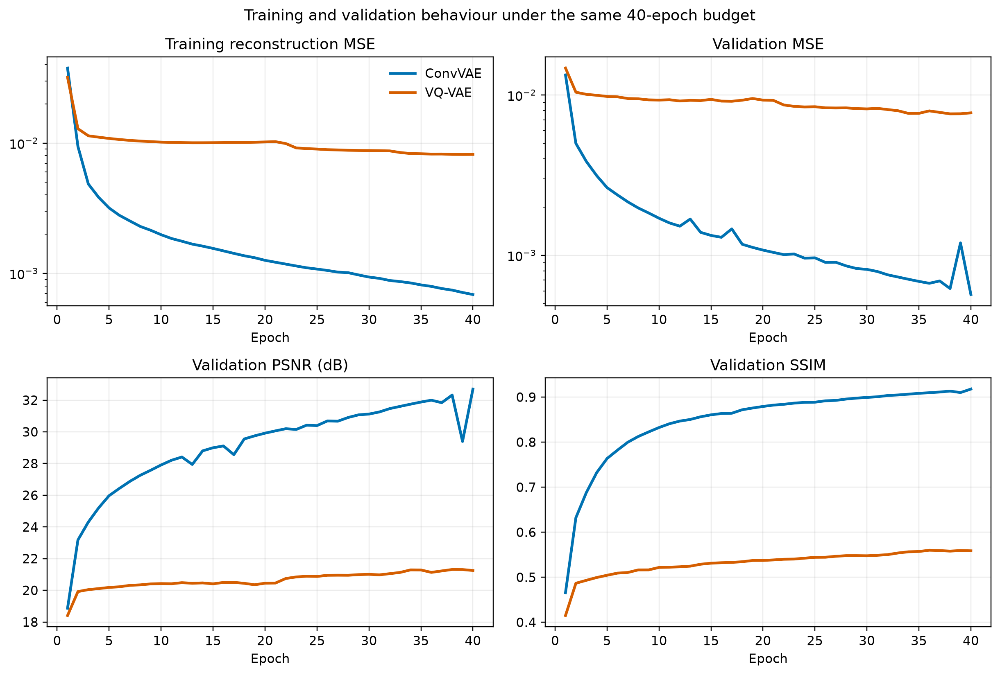
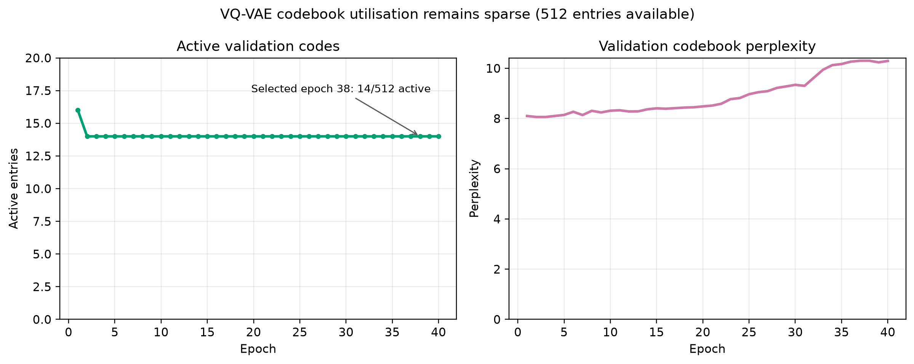
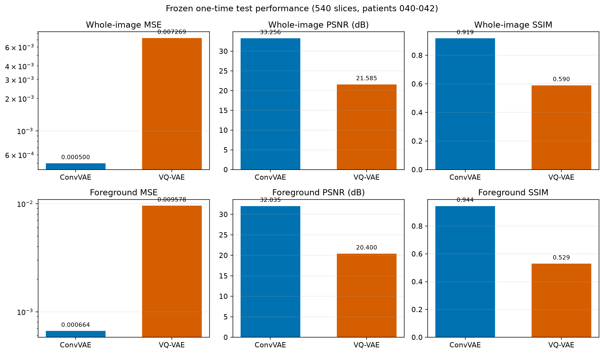
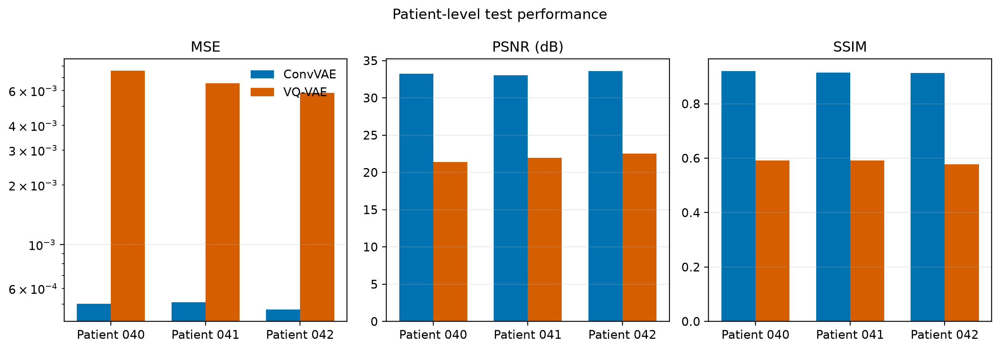
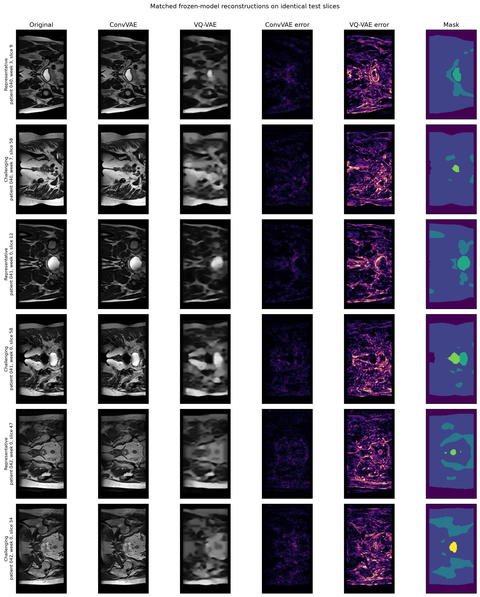

# HipMRI 2D Reconstruction with VAE and VQ-VAE

## Project status

Stage 5 completed experiment. The patient-disjoint data pipeline, both 40-epoch model
runs, validation-only checkpoint selection, guarded one-time test evaluation, and
frozen-model inference benchmark have completed successfully on A100 GPUs. The final
metrics below are now frozen; no post-test model tuning or retraining is permitted.

## Research question

Under the same patient-level data split, preprocessing, training budget, and evaluation protocol, does a VQ-VAE provide a better reconstruction-quality and representation-efficiency trade-off than a continuous-latent convolutional VAE on 2D HipMRI slices?

## Engineering dilemma and scope

The course project frames VQ-VAE as a hard-difficulty generative model for 2D
HipMRI. The engineering question is not whether a discrete latent space is novel,
but whether its operational benefit justifies the additional quantisation failure
modes. A useful prototype should reconstruct plausible anatomy, remain stable to
train, avoid patient leakage and memorisation, and provide a compact representation
without sacrificing clinically relevant boundaries.

This implementation evaluates the reconstruction and representation-learning stage
of that problem. It does **not** train an autoregressive prior over code indices, so it
does not claim unconditional generation of new patient cohorts. The comparison is
therefore deliberately scoped to fidelity, codebook utilisation, computational cost,
and failure behaviour under identical inputs. This boundary is important: a strong
reconstruction result is necessary for a useful VQ-VAE generator, but is not by itself
evidence that independently sampled images would be diverse, non-memorised, or safe
for downstream clinical training.

## Feasibility review

### User need, scope, and acceptance criteria

The intended user is an imaging research engineer deciding whether a discrete VQ-VAE
representation is worth advancing beyond a continuous-latent autoencoding baseline.
Before formal training, the prototype was considered feasible if it could:

1. build deterministic MRI/mask pairs with zero patient overlap between splits;
2. train and reload both a continuous baseline and hard-difficulty VQ-VAE end to end;
3. produce anatomically recognisable reconstructions while reporting SSIM against the
   course target of approximately 0.6 rather than hiding a miss;
4. fit comfortably on one course A100 GPU and finish each formal run within a
   one-GPU-hour budget; and
5. preserve reproducible configs, histories, checkpoints, metrics, and visual failure
   evidence without committing restricted data or model files to Git.

### Model choice and course concepts

Both models use the course concepts of convolutional feature extraction,
encoder-decoder representation learning, regularisation, held-out validation, and
quantitative reconstruction metrics. The ConvVAE is the implemented baseline because
it provides a continuous spatial latent representation with a probabilistic KL prior.
The VQ-VAE is the hard-difficulty model: it replaces continuous sampling with
nearest-neighbour vector quantisation, a learned discrete codebook, commitment loss,
and a straight-through gradient estimator. Using the same input, encoder depth,
latent width, decoder, optimiser, and training budget isolates the main variable of
interest: continuous versus discrete latent representation.

### Preliminary feasibility evidence

The initial data audit found 12,660 valid MRI/mask pairs and verified patient-disjoint
official splits. Software smoke tests confirmed `[N, 1, 256, 144]` tensors and matching
model outputs. A first limited A100 run completed the full pipeline but exposed total
VQ codebook collapse at 1/512 active entries. A revised validation-only sanity run,
using deterministic farthest-point codebook initialisation and pre-quantisation batch
normalisation, increased validation utilisation to 27 active entries after five
limited epochs and completed both models in 46 seconds. This justified proceeding to
the fixed formal budget while retaining codebook collapse as a primary risk.

### Risks, compute budget, and fallback

The main technical risks were patient leakage, VQ codebook collapse, loss of fine
anatomical texture, padded background inflating whole-image metrics, and interrupted
cluster jobs. The planned budget was one A100 GPU, 40 epochs per model, and validation-
only model selection. Mitigations included subject-level split assertions, foreground
and background metrics, active-code/perplexity tracking, resumable checkpoints, and a
guarded one-time test script. The fallback was the working ConvVAE baseline: if the
VQ-VAE failed its fidelity or utilisation criteria, the negative result would be
reported and the baseline recommended rather than tuning after test exposure.

## Methodology

### Controlled model comparison

- **Baseline:** convolutional VAE with a continuous spatial latent tensor.
- **Hard model:** VQ-VAE with a learned discrete codebook and straight-through estimator.

Both networks receive one normalised `256 x 144` MRI slice and reconstruct one slice
of the same shape. The shared encoder contains three `4 x 4`, stride-2 convolutions
with channel widths 32, 64, and 128, each followed by ReLU. It maps the input to a
`128 x 32 x 18` feature tensor. The shared decoder uses three mirrored transposed
convolutions followed by a `3 x 3` output convolution and sigmoid, returning
intensities in `[0, 1]`.

| Stage | ConvVAE baseline | VQ-VAE hard model |
| --- | --- | --- |
| Encoder | Shared 3-stage convolutional encoder | Shared 3-stage convolutional encoder |
| Latent mapping | Separate `1 x 1` heads for `mu` and `logvar` | `1 x 1` projection plus batch normalisation |
| Latent representation | Continuous `64 x 32 x 18` tensor | `32 x 18` grid of 64-D code vectors |
| Discrete capacity | Not applicable | 512 learned codebook entries |
| Decoder | Shared-capacity 3-stage decoder | Shared-capacity 3-stage decoder |
| Trainable parameters | 476,513 | 501,153 |

### Continuous ConvVAE baseline

The ConvVAE predicts a mean `mu` and log variance `logvar` at every spatial latent
location. During training it applies the reparameterisation trick,
`z = mu + exp(0.5 * logvar) * epsilon`, with standard-normal `epsilon`. During
validation and inference it decodes `mu` directly, making evaluation deterministic.
Its objective is

`L_VAE = MSE(x_hat, x) + beta * KL(q(z|x) || N(0, I))`,

where `beta = 1e-4`. The small KL weight preserves a probabilistic latent prior while
prioritising the image fidelity required by this reconstruction task.

### Hard VQ-VAE model

The VQ-VAE projects encoder features to 64 channels and batch-normalises them before
quantisation. Each 64-D vector is replaced by its nearest codebook entry under squared
Euclidean distance. The straight-through estimator passes decoder gradients to the
encoder while the codebook and encoder are trained with separate stop-gradient terms:

`L_VQ = MSE(x_hat, x) + ||sg[z_e] - e||^2 + 0.25 * ||z_e - sg[e]||^2`.

Here `z_e` is the encoder output, `e` is the selected code vector, and `sg` denotes
stop-gradient. The first training batch initialises all 512 entries using deterministic
farthest-point sampling over encoder vectors. This is performed once; subsequent
batches learn the embeddings through the codebook and commitment losses. The change
was introduced after the initial validation-only sanity run exposed single-code
collapse. Batch normalisation keeps encoder scale stable while the codebook and encoder
co-adapt.

### Codebook diagnostics

Codebook health is measured over all latent assignments in a split. An entry is active
if it receives at least one assignment. If `p_k` is the observed assignment frequency
of code `k`, perplexity is `exp(-sum_k p_k log(p_k))`. Active count reveals dead
capacity, while perplexity distinguishes nominal use from balanced use. These
diagnostics are necessary because a VQ-VAE can report a finite reconstruction loss
while silently mapping nearly every input to only a few codes.

## Experimental setup

### Dataset and leakage-safe split

The source data are the course-provided HipMRI 2D NIfTI slices. Raw data are local-only and ignored by Git.

| Split | MRI slices | Masks | Patient IDs |
| --- | ---: | ---: | --- |
| Train | 11,460 | 11,460 | 004–033 and 035 |
| Validation | 660 | 660 | 036–039 |
| Test | 540 | 540 | 040–042 |

The filename key `(patient, week, slice)` pairs every MRI with exactly one segmentation mask. The patient sets are disjoint across all three splits. Of the 12,660 MRI slices, 12,600 have shape `256 x 128`; the 60 slices from patient 019 have shape `256 x 144`. MRI values are non-negative `float32`; masks are `uint8` labels with observed values 0–5. The course-provided split membership was retained, but programmatic assertions prevent a patient from appearing in more than one split.

### Deterministic preprocessing

`dataset.py` implements the following fixed pipeline:

1. Discover the official train, validation, and test directories.
2. Pair `case_...nii.gz` and `seg_...nii.gz` files by patient, week, and slice.
3. Reject missing pairs, duplicate keys, malformed filenames, or patient overlap.
4. Load each 2D NIfTI slice without modifying the source file.
5. Clip each MRI at the 99.5th percentile of its positive pixels and scale it to `[0, 1]`.
6. Centre-pad with zeros to `256 x 144`; no image content is cropped.
7. Preserve the integer segmentation mask for later region-aware evaluation.

The per-slice normalisation is deterministic and does not use labels or statistics from other patients. Its trade-off is that absolute scanner-intensity differences between slices are removed; this limitation must be considered when interpreting results.

No stochastic data augmentation was used. This keeps both models on exactly the same
observations and avoids anatomically questionable transformations, but it also limits
the invariance learned from the relatively small patient cohort.

### Formal training configuration

| Setting | ConvVAE | VQ-VAE |
| --- | ---: | ---: |
| Epochs | 40 | 40 |
| Batch size | 64 | 64 |
| Optimiser | Adam | Adam |
| Learning rate | `2e-4` | `2e-4` |
| Random seed | 3710 | 3710 |
| Data workers | 4 | 4 |
| VAE KL weight | `1e-4` | Not applicable |
| VQ commitment weight | Not applicable | 0.25 |
| Codebook size / dimension | Not applicable | 512 / 64 |
| Device | NVIDIA A100-PCIE-40GB | NVIDIA A100-PCIE-40GB |
| Python / PyTorch | 3.11.16 / 2.14.0+cu130 | 3.11.16 / 2.14.0+cu130 |

The models were trained independently with identical data order rules and budget.
Python, NumPy, and PyTorch RNGs were seeded; deterministic PyTorch algorithms were
requested with warnings enabled. A newly seeded data-loader generator uses
`seed + epoch` for training shuffle, while validation order is fixed. Adam uses the
PyTorch default beta and epsilon values because they were not overridden.

### Model selection and frozen test protocol

Validation runs after every epoch. `best.pt` is selected by the lowest complete
validation objective, while `last.pt` supports interruption recovery. Resume restores
model state, optimiser state, epoch history, CPU RNG state, and CUDA RNG states. A
controlled interrupted-versus-continuous test produced identical histories and final
weights.

The test split was not used for checkpoint selection. After both formal runs and the
comparison protocol were frozen, guarded Slurm job `644134` evaluated the two selected
checkpoints once. Their SHA-256 hashes are reported with the final results. No model
changes or hyperparameter decisions were made after viewing test performance.

### Evaluation metrics

Metrics are computed independently for every slice and then averaged, so each slice is
one evaluation unit:

- **MSE:** mean squared pixel error; lower is better.
- **MAE:** mean absolute pixel error; lower is better.
- **PSNR:** `10 log10(1 / MSE)` for data scaled to `[0, 1]`; higher is better.
- **SSIM:** local-window structural similarity using an `11 x 11` Gaussian window with
  `sigma = 1.5`; higher is better.
- **Region-aware metrics:** the same four measures computed separately over nonzero
  anatomical mask pixels and label-0 background pixels.
- **VQ diagnostics:** active entries, dead entries, active fraction, and assignment
  perplexity.

The segmentation mask is never supplied to either model. It is used only after
reconstruction to test whether whole-image results are inflated by zero padding or
easy background. Trainable parameter count is computed directly from model parameters;
training time is the sum of measured epoch durations; peak accelerator memory is
PyTorch's maximum allocated CUDA memory. The guarded two-model test job took 22 seconds
end to end, but that total includes setup, data loading, metric calculation, and output
writing, so it is not used as per-model inference latency.

### Frozen inference-latency protocol

After model selection and test evaluation were frozen, Slurm job `644793` benchmarked
both unchanged checkpoints on an NVIDIA A100-PCIE-40GB. It used the complete 660-slice
validation split in fixed order, batch size 64, 11 batches per repetition, 10 warm-up
batches, and 20 timed repetitions. The preprocessed tensors were placed on the GPU
before timing, and CUDA was synchronised around each complete repetition. Therefore,
the reported value is amortised model-forward time per slice at batch size 64; it is
not single-request latency and excludes disk I/O, NIfTI loading, preprocessing, and
host-to-device transfer.

| Model | Median ms/slice | Q1-Q3 ms/slice | Median slices/s | Benchmark peak CUDA allocation |
| --- | ---: | ---: | ---: | ---: |
| ConvVAE | 0.1291 | 0.1290-0.1295 | 7,744.4 | 994.9 MiB |
| VQ-VAE | 0.1441 | 0.1438-0.1444 | 6,940.9 | 995.5 MiB |

Under this fixed batched protocol, the VQ-VAE is 11.6% slower per slice and provides
10.4% lower throughput than the ConvVAE. The narrow interquartile ranges show stable
repeated timing. Peak allocations are almost identical, although these benchmark
values include the validation tensors deliberately preloaded on the GPU and should not
be interpreted as single-request deployment memory. The timing result was used only
for resource comparison; it did not change either model or any selection decision.
The benchmark source commit was `b8f0ee2`, and the checkpoint hashes match those used
for the one-time test evaluation.

## Environment and manifest

From this directory:

```bash
conda activate 3710torch
python -m pip install -r requirements.txt

python dataset.py \
  --data-root data/keras_slices_data \
  --output data/manifest.csv
```

The generated manifest contains relative MRI/mask paths plus patient, week, slice, and split identifiers. Both the raw data and manifest remain under the ignored `data/` directory.

## Training and validation

`train.py` evaluates the validation split after every epoch and writes:

- `best.pt`: checkpoint with the lowest validation loss;
- `last.pt`: checkpoint from the most recent epoch;
- `history.csv`: per-epoch loss, reconstruction metrics, timings, and VQ codebook statistics;
- `config.json`: data, optimiser, reproducibility, software, device, and parameter-count settings;
- `summary.json`: best epoch, runtime, parameter count, device, and peak CUDA memory when available.

Example local sanity run:

```bash
python train.py \
  --model vae \
  --manifest data/manifest.csv \
  --output outputs/sanity-vae \
  --epochs 2 \
  --batch-size 4 \
  --max-train-batches 6 \
  --max-validation-batches 3 \
  --device cpu
```

The batch-limit options mark the run as limited in `summary.json`. They are for pipeline checks only and must not be used for final model claims.

## Checkpoint evaluation

During development, evaluate only the validation split:

```bash
python predict.py \
  --checkpoint outputs/sanity-vae/best.pt \
  --manifest data/manifest.csv \
  --split validation \
  --output predictions/sanity-vae \
  --max-batches 3 \
  --device cpu
```

The command saves per-sample MSE, MAE, PSNR, and windowed SSIM to `metrics.csv`, aggregated values to `summary.json`, and a panel of the highest-MSE cases to `worst_reconstructions.png`. VQ-VAE evaluations additionally report codebook perplexity, active codes, dead codes, and active-code fraction. The untouched test split should be evaluated only after both final models and the comparison protocol have been frozen.

Region-aware evaluation treats every nonzero segmentation label as anatomical
foreground and label 0 as background. MSE, MAE, PSNR, and local-window SSIM are
computed separately in both regions for each slice, then averaged across valid
slices. This exposes whether whole-image scores are inflated by padded or
background pixels. The masks are used only for evaluation, never as model input.

## Rangpur execution

The Rangpur workflow reuses the `comp3710lab2` Conda environment and the course account/partition pattern that was verified in earlier COMP3710 work. A live check on 8 October 2026 confirmed that the `comp3710` partition is available with A100 GPUs, the user account is associated with the `comp3710` Slurm account under normal QOS, and the existing environment contains CUDA-enabled PyTorch 2.14.0. `nibabel` was the only required package missing before installing this project's requirements. Because cluster configuration can change, run `sinfo` before every new submission and compare it with the current [EAIT Compute documentation](https://student.eait.uq.edu.au/infrastructure/compute/).

The complete login, setup, submission, monitoring, and log-inspection sequence is in
`RANGPUR_COMMANDS.txt`. Five Slurm scripts are provided:

- `slurm/gpu_sanity.sh`: short validation-only ConvVAE and VQ-VAE GPU pipeline check;
- `slurm/train_vae.sh`: formal ConvVAE baseline training and validation evaluation;
- `slurm/train_vqvae.sh`: formal VQ-VAE training and validation evaluation under the same defaults;
- `slurm/evaluate_test.sh`: guarded one-time test evaluation of both frozen checkpoints; and
- `slurm/benchmark_latency.sh`: validation-only A100 timing of both frozen checkpoints.

The reported formal jobs used 40 epochs, batch size 64, learning rate `2e-4`, seed
3710, four data workers, and one GPU. The training scripts retain environment-variable
overrides for future reproducibility checks, but the frozen results use these stated
values.

Every epoch writes `last.pt`; the best validation checkpoint remains in `best.pt`. If Slurm requeues a job, the scripts detect `last.pt` and pass `--resume`. The trainer restores the model, optimiser, epoch history, and PyTorch random state. A local interrupted-versus-continuous test produced identical metric histories and exactly equal final model weights.

## Smoke tests

Software-only model test:

```bash
python train.py --smoke-test
```

The data-loader verification produced batches with shape `[N, 1, 256, 144]`, `float32` MRI values in `[0, 1]`, and integer masks. Both VAE and VQ-VAE returned reconstructions of the same shape.

An intentionally limited CPU run also verified the full artifact pipeline. The ConvVAE completed two epochs over 6 training and 3 validation batches per epoch, selected epoch 2 as the best checkpoint, and reloaded it using PyTorch's safe `weights_only=True` mode. The first A100 feasibility run completed both models and all evaluation outputs in 65 seconds, but exposed a collapsed VQ codebook with only 1/512 active entries. That diagnostic result motivated the deterministic data-dependent codebook initialisation and pre-quantisation normalisation above.

The revised A100 sanity job `642126` completed successfully in 46 seconds with exit code `0:0`, an empty error log, and peak host memory of about 1.74 GiB. Across five deliberately limited VQ-VAE epochs, validation active-code count changed from 7 to 16, 25, 29, and 27; validation perplexity increased from 1.66 to 7.78; PSNR increased from 10.72 to 17.64 dB; and SSIM increased from 0.1257 to 0.2977. This confirms that the single-code collapse was removed, although the remaining sparse utilisation must still be monitored during formal training. All sanity results are diagnostic only and must not be presented as final model-quality evidence.

## Frozen validation results

In Figures 1-4, the ConvVAE is the continuous-latent baseline and the VQ-VAE is
the hard-difficulty advanced model. Both use the same official patient-disjoint
splits, deterministic preprocessing, 40-epoch budget, batch size, optimiser,
random seed, and evaluation metrics. The comparison therefore isolates the
representation choice rather than a different data or compute allocation.

Both models completed the same 40-epoch, batch-size-64 budget on an A100 GPU.
Checkpoint selection used validation objective only; the test patients were not
accessed. The frozen VAE checkpoint is epoch 40 and the frozen VQ-VAE checkpoint
is epoch 38.

| Model | Parameters | Training time | Peak GPU memory | MSE | MAE | PSNR | SSIM |
| --- | ---: | ---: | ---: | ---: | ---: | ---: | ---: |
| ConvVAE | 476,513 | 1,888.9 s | 1,348.9 MiB | 0.000569 | 0.014757 | 32.698 dB | 0.9178 |
| VQ-VAE | 501,153 | 1,923.7 s | 1,348.9 MiB | 0.007637 | 0.055121 | 21.312 dB | 0.5579 |



*Figure 1. Training and validation behaviour under the shared 40-epoch budget.*

The ConvVAE improves throughout training and finishes with substantially lower
validation MSE and higher PSNR/SSIM. Its isolated validation fluctuation at epoch 39
recovers at epoch 40. The VQ-VAE improves sharply at the start but then plateaus near
validation MSE 0.008 and SSIM 0.56. Because its training and validation reconstruction
curves level off together, the main limitation is underfitting/representation capacity
under this configuration rather than a widening train-validation overfitting gap.

The frozen VQ-VAE uses 14/512 entries on validation (2.73% active) with
perplexity 10.30. It therefore avoids total collapse but learns a highly sparse
discrete representation. This is a substantive negative result, not a reason
to change the model after seeing validation outcomes.



*Figure 2. Formal VQ-VAE validation codebook utilisation across training.*

Active utilisation falls from 16 entries in the first epoch to 14 and then remains
flat, while perplexity rises from about 8.1 to 10.3. The assignments become somewhat
more balanced within that small active subset, but 498 of 512 entries remain unused.
This is partial codebook collapse: the model is not mapping everything to one entry,
yet most of the intended discrete capacity contributes nothing to the representation.

## Final one-time test results

Slurm job `644134` evaluated all 540 slices from held-out patients 040–042 once,
completed in 22 seconds with exit code `0:0`, and produced an empty error log.
The frozen checkpoint hashes were:

- ConvVAE: `1da683f0d4afcf7704f236827380dde4f1999acfbff7f3256ddef75224ea63e1`
- VQ-VAE: `5f1aa0c74259f4a7d3614ef9fba302c34d1cfcb96ac67052c5deec52325cf8a9`

| Model | MSE | MAE | PSNR | SSIM | Foreground PSNR | Foreground SSIM |
| --- | ---: | ---: | ---: | ---: | ---: | ---: |
| ConvVAE | 0.000500 | 0.013314 | 33.256 dB | 0.9185 | 32.035 dB | 0.9441 |
| VQ-VAE | 0.007269 | 0.051884 | 21.585 dB | 0.5897 | 20.400 dB | 0.5294 |

| Model | Background MSE | Background MAE | Background PSNR | Background SSIM |
| --- | ---: | ---: | ---: | ---: |
| ConvVAE | 0.000025 | 0.002058 | 46.237 dB | 0.8444 |
| VQ-VAE | 0.000593 | 0.006254 | 32.735 dB | 0.7668 |



*Figure 3. Frozen one-time aggregate test comparison over 540 slices from patients 040-042.*

The ConvVAE test MSE is about 14.5 times lower, PSNR is 11.67 dB higher,
and SSIM is 0.329 higher than the VQ-VAE. The same conclusion holds within
segmented anatomical foreground, so the result is not explained by padded
background pixels. Test metrics are close to or slightly better than validation
metrics for both models, with no evidence of a held-out-patient generalisation
collapse.



*Figure 4. Patient-level test performance for each held-out subject.*

The ConvVAE has lower MSE and higher PSNR and SSIM for every held-out patient, so the
aggregate advantage is not caused by a single favourable subject. This check matters
because patient 040 contributes 420 of the 540 slices, whereas patients 041 and 042
contribute 60 each. Patient 042 gives the VQ-VAE its highest PSNR but lowest SSIM,
which also shows why a single pixel metric is insufficient for model selection.

The VQ-VAE uses 13/512 codes on test (2.54% active) with perplexity 10.46,
closely matching validation. Its representation is discrete and compact at the
index level, but the chosen 512-entry codebook is heavily under-utilised and its
reconstruction loss is substantial. Under this controlled budget, the ConvVAE
is the recommended model for HipMRI reconstruction quality and stability.

## Matched qualitative failure autopsies

Here, a *failure case* means a lower-performing model/data example, not a coding
mistake or a clinical diagnosis. The frozen selection rule chooses, for each test
patient, the slice nearest that patient's median VQ-VAE MSE and the slice with the
maximum VQ-VAE MSE. Both models are then rendered on the identical input. The error
maps within each row use the same colour scale, so their intensity is directly
comparable within that row but not across different rows.



*Figure 5. Deterministically selected matched reconstructions from all three held-out patients.*

The five cases below include all three patient-specific maxima plus two median-error
examples. This covers every held-out patient while testing whether the observed pattern
also occurs away from the extrema. The unused patient 041 median example remains in
Figure 5 and `matched_test_selection.csv` for auditability.

| Case | Selection basis | ConvVAE MSE / SSIM | VQ-VAE MSE / SSIM |
| --- | --- | ---: | ---: |
| Patient 040, week 3, slice 9 | Representative (subject median VQ-VAE MSE) | 0.000432 / 0.9205 | 0.006795 / 0.5978 |
| Patient 040, week 7, slice 58 | Challenging (subject maximum VQ-VAE MSE) | 0.000855 / 0.8980 | 0.012125 / 0.5372 |
| Patient 041, week 0, slice 58 | Challenging (subject maximum VQ-VAE MSE) | 0.000765 / 0.9015 | 0.010106 / 0.5328 |
| Patient 042, week 0, slice 47 | Representative (subject median VQ-VAE MSE) | 0.000474 / 0.9073 | 0.005982 / 0.5715 |
| Patient 042, week 0, slice 34 | Challenging (subject maximum VQ-VAE MSE) | 0.000707 / 0.9037 | 0.008047 / 0.5366 |

### Case 1: patient 040, week 3, slice 9 - representative

**Observed:** The ConvVAE preserves the bright central region, its boundary, and much
of the surrounding texture. The VQ-VAE retains the coarse location but visibly smooths
the boundary and nearby fine structure. Its error map contains a bright boundary ring
and widespread responses along tissue interfaces; its MSE is 15.72 times the ConvVAE's.
**Possible trigger and risk:** A sharp local intensity transition surrounded by
high-frequency texture may be poorly represented by the sparse discrete codebook.
That causal explanation is an inference, but the directly observed loss of boundary
precision would be risky for any downstream use that depends on small spatial details.
Because this is a patient-median example and the same smoothing appears in other rows,
the pattern is systematic rather than an isolated outlier.

### Case 2: patient 040, week 7, slice 58 - challenging

**Observed:** This patient-specific maximum contains heterogeneous bright and dark
regions with several thin transitions. The VQ-VAE merges or softens many of them,
whereas the ConvVAE follows the original more closely. The VQ-VAE error is distributed
across much of the non-background image and reaches MSE 0.012125, the largest of the
six displayed selections. **Possible trigger and risk:** Dense, high-frequency content
may exceed what the small active code subset can encode. The exact severity is an
extreme case, but the underlying smoothing is systematic across patients. Fine or
narrow structures could be suppressed before later analysis.

### Case 3: patient 041, week 0, slice 58 - challenging

**Observed:** The VQ-VAE reconstructs the broad intensity layout but blurs the edges
of adjacent bright and dark regions. The strongest error-map responses follow those
interfaces, while the ConvVAE error remains much weaker under the shared row scale.
The VQ-VAE MSE is 13.21 times higher. **Possible trigger and risk:** Closely spaced,
high-contrast boundaries may be quantised to representations that are too similar.
This is a qualified mechanism rather than a proven cause. The cross-patient recurrence
supports a systematic boundary-preservation limitation with a risk of merging nearby
structures.

### Case 4: patient 042, week 0, slice 47 - representative

**Observed:** The original contains multiple small rounded and elongated features.
The ConvVAE retains their separation, while the VQ-VAE smooths them into a coarser
appearance; the corresponding error map traces many local edges. Even at the patient's
median VQ-VAE error, its MSE is 12.62 times the baseline's. **Possible trigger and
risk:** Several nearby low-contrast details may require more discrete capacity than
the 13 active test codes provide. The median-based selection makes this evidence of a
systematic loss of fine-detail separability, not just a maximum-error anomaly. The
operational risk is that distinct nearby features could be merged in a downstream
representation.

### Case 5: patient 042, week 0, slice 34 - challenging

**Observed:** This slice has an unusually heterogeneous, speckled bright region in the
original. The ConvVAE reproduces much of that local variation, whereas the VQ-VAE
replaces it with a smoother pattern and produces concentrated error in the same area.
**Possible trigger and risk:** The distinctive appearance could represent uncommon
image content, acquisition noise, or both; the available evidence cannot distinguish
these explanations. Therefore this exact trigger may be isolated, but the model's
smoothing response is consistent with the other cases. A system that suppresses rare
or noisy-looking detail without flagging uncertainty could conceal atypical inputs.

Across these five cases, the direct evidence supports one dominant systematic failure
mode: VQ-VAE over-smoothing at fine structures and intensity boundaries. Case 5 may
also contain an isolated unusual-appearance component, but no clinical or causal claim
is made. The masks were used only to contextualise error locations, not as model input
or evidence that a reconstruction is medically acceptable.

## Evaluation outputs

- Reconstruction: MSE, MAE, PSNR, and SSIM on the fixed test split.
- VQ-VAE representation: codebook perplexity, active-code fraction, and dead codes.
- Resources: parameter count, training time, peak accelerator memory, and independent
  frozen-model inference latency/throughput.
- Qualitative analysis: original/reconstruction/error-map panels for six lower-performing test cases per model.
- Region-aware foreground/background analysis using masks only during evaluation.
- Final recommendation based on quality, stability, resource use, and observed failure modes.

## Reproducible report assets

After retrieving the frozen artifacts from Rangpur, generate the report figures and
tables locally with:

```bash
conda activate 3710torch
python make_report_assets.py --device cpu
```

The script first verifies both frozen checkpoint SHA-256 hashes. It then reads the
saved histories, summaries, and per-slice CSV files to produce training curves,
test-set comparison plots, codebook diagnostics, patient-level robustness results,
and report-ready CSV tables under `report_assets/`. It does not train either model
or recompute the frozen aggregate test metrics.

For qualitative comparison, the script selects one median-error-nearest and one
maximum-error VQ-VAE slice from each test patient, then renders both frozen models
on those same six inputs. This creates a matched comparison rather than juxtaposing
different model-specific worst cases. The selection rule, job ID, and checkpoint
hashes are retained in `report_assets/provenance.json`.

The independent A100 timing evidence is stored in
`report_assets/inference_latency/summary.json` and `summary.csv`. The JSON retains all
20 repetition measurements, protocol boundaries, software/device versions, sample
identity, source commit, and checkpoint hashes; the CSV provides the two concise rows
used in the report.

## Required files

- `modules.py`: ConvVAE, vector quantiser, VQ-VAE, and loss functions.
- `dataset.py`: NIfTI discovery, pairing, leakage checks, manifest generation, and loading.
- `metrics.py`: shared MSE, MAE, PSNR, and windowed SSIM implementation.
- `train.py`: training, validation, best-checkpoint selection, configuration, and history logging.
- `predict.py`: safe checkpoint loading, per-sample evaluation, and failure-case visualisation.
- `benchmark_latency.py`: frozen-checkpoint validation benchmark and CSV/JSON evidence generation.
- `make_report_assets.py`: frozen-result verification and reproducible report figures/tables.
- `slurm/`: Rangpur sanity, baseline, and VQ-VAE batch scripts with automatic resume.
- `slurm/evaluate_test.sh`: guarded one-time evaluation of both frozen checkpoints.
- `slurm/benchmark_latency.sh`: fixed A100 latency benchmark for both frozen checkpoints.
- `RANGPUR_COMMANDS.txt`: copyable Rangpur setup, monitoring, and evidence commands.
- `README.md`: experiment protocol, commands, evidence, and findings.

## Immediate next steps

1. Draft the final report from the frozen tables, figures, and interpretation in `report_assets/`.
2. Add the assignment-required AI-use disclosure and retain the development evidence.
3. Verify the final document against the marking criteria and page/format limits.
4. Preserve the source commit and checkpoint hashes with the final submission evidence.
