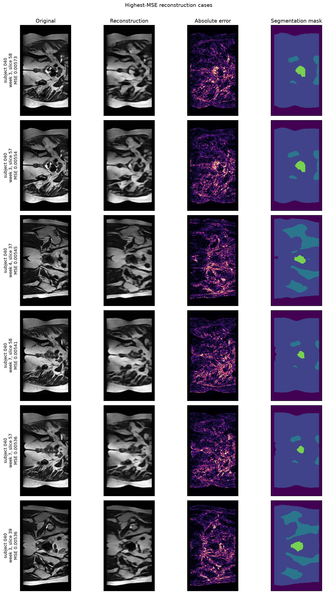

# VQ-VAE v2 Post-hoc Follow-up

## Protocol boundary

VQ-VAE v2 was designed after the primary VQ-VAE v1 test result had already
been observed. Its architecture and checkpoint were selected using validation
data only, and the test split was then evaluated once. The result is therefore
reported as a post-hoc engineering follow-up, not as a replacement untouched-test
result for the original controlled comparison.

## Configuration

- 60 epochs; selected epoch 60 by validation SSIM.
- 128-entry, 64-dimensional codebook.
- EMA codebook update with decay 0.99 and dead-code patience 100.
- Reconstruction objective: MSE plus 0.10 times SSIM loss, with commitment weight 0.25.

## Aggregate reconstruction evidence

| Split | Model | MSE | MAE | PSNR | SSIM | Active codes | Perplexity |
| --- | --- | ---: | ---: | ---: | ---: | ---: | ---: |
| Validation | V1 | 0.007637 | 0.055121 | 21.312 | 0.5579 | 14/512 | 10.30 |
| Validation | V2 | 0.003683 | 0.037116 | 24.522 | 0.7509 | 128/128 | 110.71 |
| Test | V1 | 0.007269 | 0.051884 | 21.585 | 0.5897 | 13/512 | 10.46 |
| Test | V2 | 0.003335 | 0.033971 | 24.999 | 0.7730 | 128/128 | 108.87 |

On test, V2 improves SSIM for 540/540 matched slices and MSE for 540/540. Mean paired SSIM increases by 0.1833, while mean paired MSE changes by -0.003934.

V2 test foreground SSIM is 0.7424, so the improvement is not explained by padded background. All 128 codes are active and perplexity is 108.87; no dead codes remain.

The highest-MSE examples retain gross anatomical layout but still smooth fine texture and tissue boundaries. No catastrophic spatial displacement or checkerboard artefact is visible in this panel.

## Interpretation boundary

V2 solves the approximate 0.6 reconstruction-SSIM target within this follow-up, but it remains below the ConvVAE primary test SSIM of 0.9185. The existing PixelCNN prior was trained on the 512-entry V1 code space and is incompatible with the 128-entry V2 codebook. No unconditional-generation claim is therefore made for V2; a new prior and a new untouched evaluation protocol would be required.
